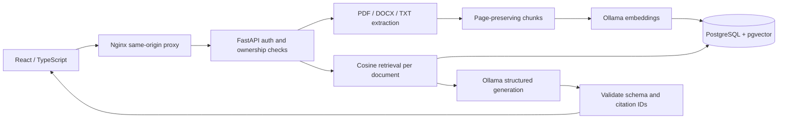

# ClauseCompass

**Contract intelligence, with a paper trail.**

A full-stack portfolio project for uploading contracts, finding relevant passages, asking cited questions, comparing agreement versions, and extracting structured terms. The React workspace talks to a Python API; PostgreSQL stores document metadata, extracted text, and semantic vectors. Ollama runs both AI models locally.

**Status:** implemented starter, not a production legal service. No live cloud deployment or measured AI-quality claim is implied. See [verification](docs/VERIFICATION.md) and [production roadmap](docs/ROADMAP.md).

## What this demonstrates

| Job requirement | Evidence in this repository |
|---|---|
| React / TypeScript frontend | Document workspace, account flow, upload, multi-document selection, source inspector, responsive layout |
| Python / FastAPI | Typed REST endpoints, structured validation, provider error handling, request IDs |
| Document ingestion | PDF page extraction, DOCX paragraphs/tables, UTF-8 text, bounded uploads, duplicate detection |
| Chunking / embeddings / search | Page-preserving overlapping chunks, Ollama embeddings, exact pgvector cosine search |
| RAG | Retrieval per selected document, source-only prompts, structured answers, citation-ID validation |
| Review and comparison | Agreement summaries, parties/dates/obligations/clauses, draft risks, focused two-document comparison |
| Authentication / data boundaries | Argon2 password hashes, signed HttpOnly cookies, per-account ownership filters, CSRF header requirement |
| Delivery / operations | Docker Compose, CI with real PostgreSQL, container publishing workflow, structured logs |
| Evaluation | Synthetic fixtures, retrieval benchmark runner, adversarial citation and cross-account tests |
| AWS / Azure | An explicit [AWS deployment design](docs/DEPLOYMENT.md); cloud deployment remains follow-up work |

Node.js builds the frontend. There is one backend in Python; an additional Node API would duplicate responsibilities without improving this project.

## Run locally

Prerequisites: Docker Desktop with Compose enabled, and [Ollama](https://ollama.com/) installed and running. Initial model downloads require internet access and several GB of disk space; CPU inference can be slow.

```sh
ollama pull nomic-embed-text
ollama pull llama3.2
```

Copy `.env.example` to `.env`. Replace both placeholder secrets with random values. Use at least 32 characters for `JWT_SECRET`; use a URL-safe alphanumeric database password because Compose includes it in a connection URL. You can generate each value with `python -c "import secrets; print(secrets.token_hex(32))"`.

```sh
docker compose up --build
```

Open **http://localhost:8080**, create an account with a password of at least 12 characters, and upload the two files in `samples/`. The web port binds only to localhost. The database and API are not published to the host.

Ollama must be reachable from the API container at `OLLAMA_URL`. Docker Desktop generally exposes host services through `host.docker.internal`. On Linux, you may need to adjust Ollama's bind address and firewall so the Docker bridge can reach it. Keep the model endpoint private; it is unauthenticated by default.

If uploads report an AI-provider error, check `ollama list`, `OLLAMA_URL`, and `docker compose logs api`. A green `/health` response confirms database access, not model readiness.

## A five-minute interview demo

1. Upload `northstar-services-v1.txt`; explain extraction, overlap, page provenance, embeddings, and atomic persistence.
2. Ask **“What payment obligations apply?”** Open a cited source to verify the monthly fee and payment period.
3. Click **Summarize & extract key terms** to inspect summary, structured facts, and draft risks.
4. Upload version 2 and select both. Ask **“How did termination rights and liability limits change?”** Verify evidence from both versions. This is focused semantic comparison, not a complete redline.
5. Ask **“What is the account number for wire transfers?”** The agreements do not state one; assess whether the model abstains.
6. Use a second account to demonstrate that documents are private. Show the integration test that attempts direct cross-account access.
7. Explain the measured limits: citation validity does not prove entailment; search retrieves only a subset; small-model answers can be wrong.

## Architecture



Upload processing is synchronous and publishes documents only after all embeddings are available. Database writes commit together. Failed ingestion leaves no partially searchable document. Raw uploaded bytes are discarded; extracted text and embeddings remain until deletion. Original-file download is not implemented.

Search uses exact cosine ranking within the current account's selected documents. The default `nomic-embed-text` model produces 768-dimensional vectors. Changing embedding models requires re-ingestion and potentially a schema migration. Model names are recorded per document. Pin model digests before benchmarking or release.

## API surface

All mutation requests need `X-Requested-With: ClauseCompass`. Browser authentication uses the `session` HttpOnly cookie. Swagger is available through `/api/docs`; its default mutation requests lack this header, so use a client that sets it.

| Route | Purpose |
|---|---|
| `POST /auth/register`, `POST /auth/login` | Create or open a session |
| `POST /auth/logout`, `GET /auth/me` | End or inspect a session |
| `GET /documents`, `POST /documents` | List owned documents or ingest an upload |
| `GET /documents/{id}/chunks` | Inspect extracted passages |
| `DELETE /documents/{id}` | Delete metadata and indexed passages |
| `POST /search` | Semantic passage retrieval |
| `POST /ask` | Cited answer; two selected IDs enable focused comparison |
| `POST /documents/{id}/review` | Full-document review for documents up to 20 chunks |
| `GET /health` | Database readiness |

## Tests and evaluation

```sh
cd backend
python -m venv .venv
# Activate .venv using your shell's activation command.
pip install -r requirements.txt
python -m pytest -q
```

Tests requiring PostgreSQL skip locally unless `RUN_DB_TESTS=1` and `DATABASE_URL` points to a database initialized with `backend/schema.sql`. GitHub Actions provisions that database and runs the integration suite. Test model responses are stubs; they do not measure actual LLM quality.

```sh
cd frontend
npm ci
npm run build
```

With the complete app running and backend dependencies installed, run from repository root:

```sh
python evals/run.py
```

The evaluator uses real embeddings, creates a temporary account, uploads synthetic fixtures, prints hit rate and reciprocal rank at five, then deletes uploaded fixtures. The account remains. Use a disposable demo database. Six short synthetic cases are only a smoke benchmark; expand the corpus before drawing quality conclusions.

## Repository guide

```text
backend/app/         API, auth, extraction, AI provider, database helpers
backend/tests/       Unit and PostgreSQL integration tests
backend/schema.sql   Initial schema; runs only on a fresh Docker data volume
frontend/src/        React workspace and styling
samples/             Two synthetic agreements with intentional differences
evals/               Retrieval fixtures and live benchmark runner
.github/workflows/   Quality checks and manually triggered image publishing
docs/                Architecture decisions, deployment plan, verification, roadmap
```

## Known boundaries

- Text PDFs only; scanned PDFs need OCR. Mixed scanned/text PDFs can have incomplete extraction. Table reading order and DOCX layout are not guaranteed.
- Maximum 10 MB upload, 100 PDF pages, and 300,000 extracted characters. Full structured review rejects documents over 20 chunks rather than truncating silently.
- Question answering retrieves five chunks per selected document. It cannot certify that a clause is absent from the whole agreement.
- No durable ingestion queue, OCR, team roles, SSO, account recovery, immutable audit ledger, or server-side session revocation yet.
- Ownership checks are implemented at the application layer. PostgreSQL row-level security and a restricted runtime database role are follow-up work.
- The local database volume is not encrypted by this project. Deletion removes live rows; backup retention is a separate deployment responsibility.
- Do not expose this local demo to the internet as-is. See the concrete gaps in [SECURITY.md](SECURITY.md).

## GitHub repository

Repository: [arjun-paramai/ai-app](https://github.com/arjun-paramai/ai-app).

```sh
git clone https://github.com/arjun-paramai/ai-app.git
cd ai-app
```

Follow the local setup instructions above. GitHub Actions runs quality checks on pushes and pull requests. After checks pass, optionally run **Publish containers** manually to publish commit-tagged GHCR images. This does not deploy a cloud environment.

`.env`, caches, build outputs, and dependencies are ignored. Review staged files before committing any local changes.

## Technical references

- [pgvector](https://github.com/pgvector/pgvector): cosine distance and exact/approximate vector retrieval.
- [FastAPI container deployment](https://fastapi.tiangolo.com/deployment/docker/): containerized application deployment.
- [Ollama API](https://github.com/ollama/ollama/blob/main/docs/api.md): embedding and structured chat interfaces.
- [PostgreSQL row security](https://www.postgresql.org/docs/17/ddl-rowsecurity.html): planned defense in depth for tenant boundaries.
